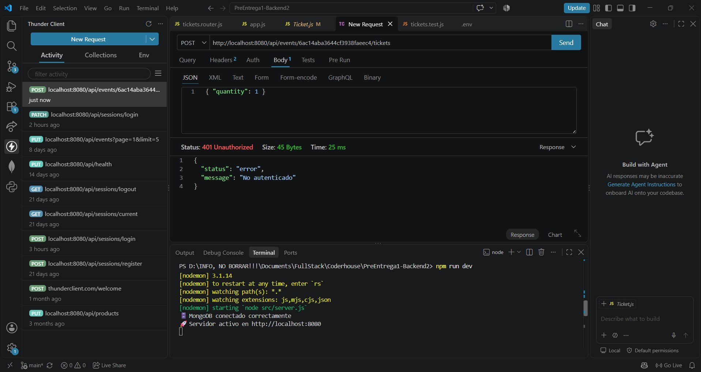
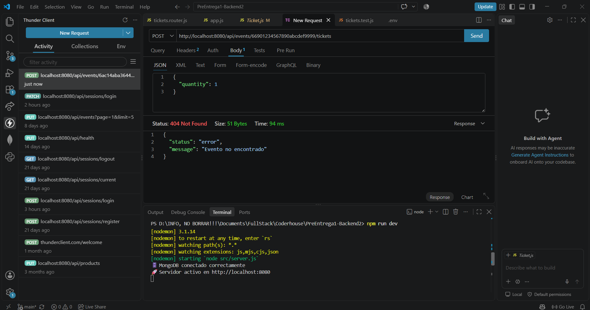
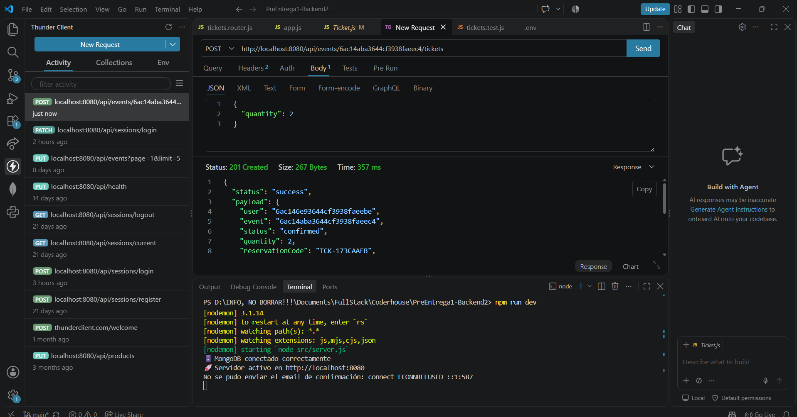
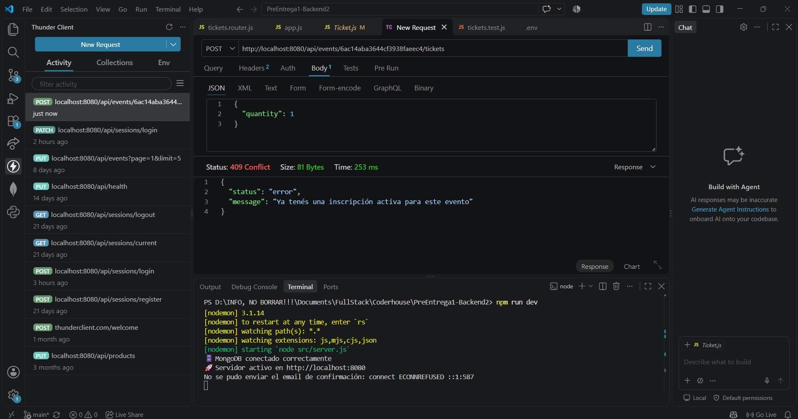
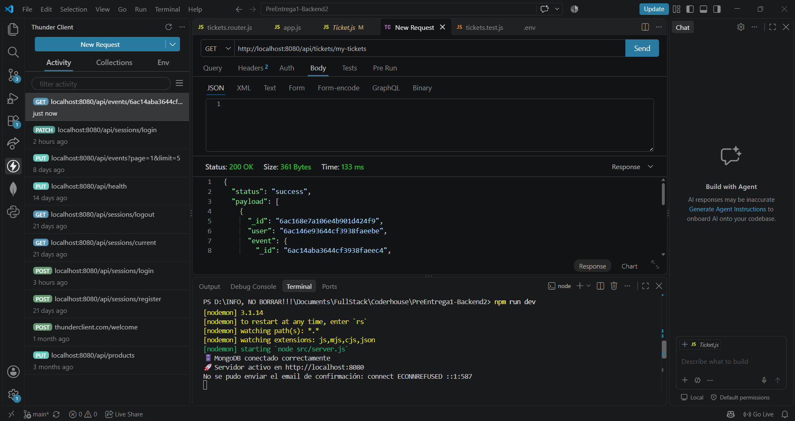
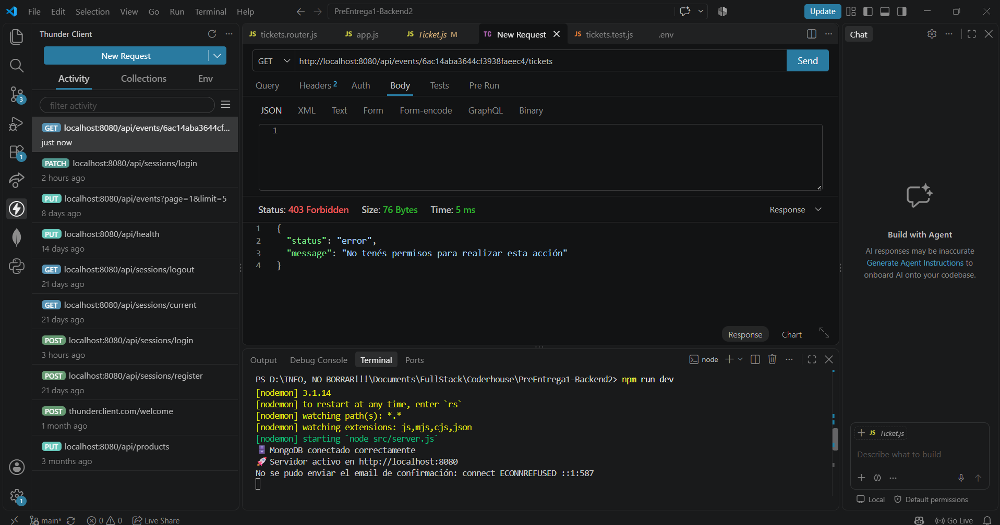
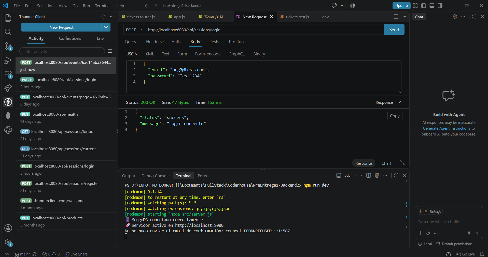
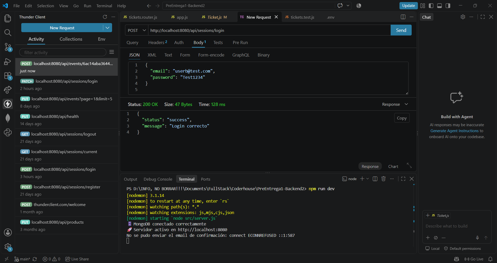
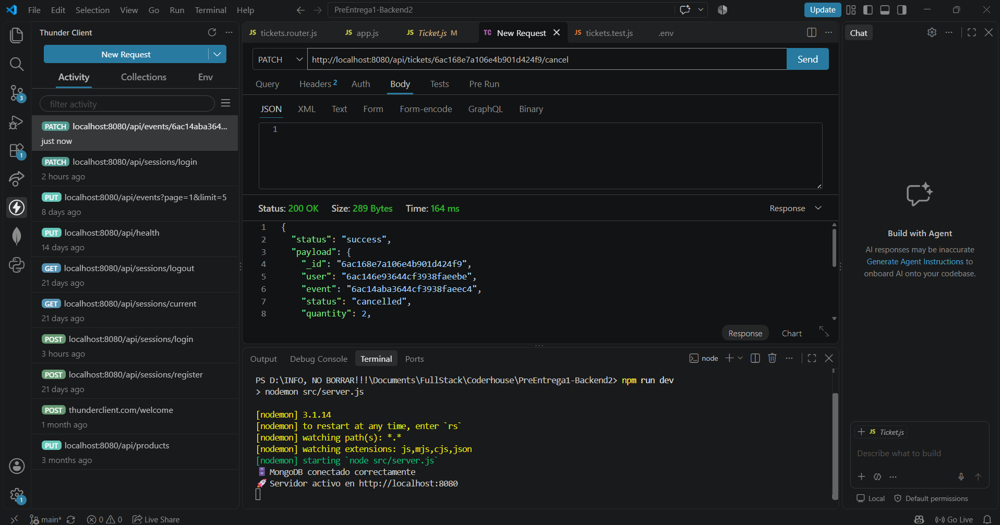

# Johana Aylén Parrello

# Plataforma de Eventos e Inscripciones

API REST desarrollada con Node.js y Express para la gestión integral de eventos, reserva de tickets e inscripciones con control de cupos, autenticación, autorización y notificaciones por correo electrónico.

El proyecto implementa una arquitectura por capas: **Router → Controller → Service → Repository → DAO → Modelo**, complementada con DTOs para controlar los datos expuestos por la API.

Este repositorio corresponde a la **Pre-entrega 8 de Backend II (Coderhouse): Arquitectura con DAO, Repository y DTO**. Refactoriza las funcionalidades de sesiones, usuarios, eventos, tickets e inscripciones sin cambiar el comportamiento externo de los endpoints.

---

## Características de la Pre-entrega 8

### Entidad `Ticket`

- Referencias `ObjectId` a `user` (`ref: 'User'`) y `event` (`ref: 'Event'`), sin almacenar documentos completos embebidos.
- Control de estados mediante enum: `confirmed`, `pending` y `cancelled`.
- Campos para la cantidad de lugares (`quantity`), código de reserva único (`reservationCode`), fecha de creación (`createdAt`) y fecha de cancelación (`cancelledAt`).

### Arquitectura por capas

- **DAO:** encapsula el acceso a los modelos de Mongoose y las operaciones de base de datos.
- **Repository:** actúa como intermediario entre los servicios y los DAO.
- **Services:** concentran las reglas de negocio y las validaciones.
- **Controllers:** coordinan las solicitudes y respuestas HTTP sin importar modelos de Mongoose.
- **DTOs:** controlan la información que se devuelve al cliente y evitan exponer contraseñas, incluso cuando se utiliza `populate`.

### Lógica de negocio de tickets

La lógica de negocio reside en `src/services/tickets.service.js` e incluye:

- Validación del formato de los identificadores y existencia de los recursos.
- Validación del estado del evento y de su fecha.
- Validación de la cantidad de lugares solicitados.
- Control atómico de cupos mediante `findOneAndUpdate` y el contador `reservedSeats`.
- Prevención de inscripciones duplicadas activas.
- Control de propiedad del ticket y permisos de administración.
- Cancelación lógica de inscripciones y liberación de cupos.
- Envío de notificaciones por correo electrónico.

**Control de cupos atómico:** el evento guarda un contador `reservedSeats` que se incrementa con una única operación de MongoDB (`findOneAndUpdate`) solo si hay lugar, evitando la sobreventa con pedidos simultáneos. Si no hay cupo suficiente responde `409 Conflict` con los lugares restantes.

### Cancelación lógica y liberación de cupos

- El ticket cambia a estado `cancelled` y registra la fecha en `cancelledAt`, sin eliminarse físicamente de la base de datos.
- Al cancelar se libera el cupo (`reservedSeats`) y se envía un email de cancelación al usuario dueño del ticket.
- Únicamente el dueño del ticket o un administrador pueden cancelarlo.

### Consulta de tickets propios

Endpoint: `GET /api/tickets/my-tickets`.

- Devuelve las inscripciones del usuario autenticado.
- Utiliza `populate` en el evento para mostrar únicamente los datos necesarios, como `title`, `date` y `location`.
- No expone contraseñas ni información sensible.

### Consulta de inscriptos por evento

Endpoint: `GET /api/events/:eid/tickets`.

- Permite el acceso al organizador propietario del evento o a un administrador.
- Utiliza `populate` del usuario para mostrar `first_name`, `last_name` y `email`.
- No expone el campo `password` en la respuesta.

### DTOs (Data Transfer Objects)

- `user.dto.js`: transforma los datos del usuario y excluye el campo `password`.
- `event.dto.js`: define la representación del evento que recibe el cliente.
- `ticket.dto.js`: controla la estructura de la respuesta del ticket y filtra datos sensibles de los documentos relacionados mediante `populate`.

### Manejo centralizado de errores

El middleware `src/middlewares/error.middleware.js` centraliza el tratamiento de errores y mantiene un formato consistente para las respuestas.

Se contemplan los siguientes códigos HTTP:

- `400 Bad Request`: datos o solicitudes inválidos.
- `401 Unauthorized`: falta autenticación válida.
- `403 Forbidden`: permisos insuficientes.
- `404 Not Found`: recurso inexistente.
- `409 Conflict`: conflicto de negocio, como cupos insuficientes o inscripción duplicada.
- `500 Internal Server Error`: error interno inesperado.

### Notificaciones automáticas con Nodemailer

- Envío de correo de confirmación al registrarse una inscripción.
- Envío de correo de cancelación al dueño del ticket cuando se cancela su inscripción.
- Si falla el servicio de correo durante la confirmación, la inscripción permanece registrada.
- Las credenciales del servicio de correo se configuran mediante variables de entorno.

### Suite de tests automatizados

El proyecto cuenta con **42 tests automatizados** con Jest y Supertest que cubren autenticación, roles, eventos, tickets, control de cupos, cancelaciones, notificaciones y respuestas HTTP.

---

## Tecnologías

- **Node.js** (v18 o superior)
- **Express** (v4)
- **Mongoose** (ODM para MongoDB)
- **Nodemailer** (notificaciones por correo electrónico)
- **Passport.js** (`passport-local` y `passport-jwt`)
- **JSON Web Token** (`jsonwebtoken`)
- **Bcrypt** (hash de contraseñas)
- **Cookie-parser** (manejo de cookies)
- **Dotenv** (variables de entorno)
- **Jest** y **Supertest** (pruebas automatizadas)
- **Cross-env** (compatibilidad multiplataforma para scripts)
- **Nodemon** (entorno de desarrollo)

---

## Arquitectura del proyecto

La API implementa una arquitectura por capas que separa las responsabilidades y facilita el mantenimiento, las pruebas y la evolución del sistema.

El flujo general de una petición es:

```text
Petición HTTP
     │
     ▼
   Router
     │
     ▼
 Controller
     │
     ▼
   Service
     │
     ▼
 Repository
     │
     ▼
    DAO
     │
     ▼
Modelo Mongoose → MongoDB
```

Las respuestas que contienen datos de usuario, eventos o tickets se transforman mediante DTOs antes de enviarse al cliente.

### Arquitectura en capas

| Capa | Responsabilidad |
|---|---|
| **Router** | Define los endpoints y aplica los middlewares de autenticación y autorización. |
| **Controller** | Extrae los datos de la petición, llama al servicio correspondiente y coordina la respuesta HTTP. |
| **Service** | Concentra las reglas de negocio: validaciones, estados, cupos, duplicados, permisos sobre recursos propios y notificaciones. |
| **Repository** | Actúa como intermediario entre los servicios y los DAO, exponiendo operaciones orientadas al dominio. |
| **DAO (Data Access Object)** | Encapsula las consultas y operaciones de acceso a datos mediante Mongoose. |
| **Modelo** | Define los esquemas, campos, referencias y restricciones de las entidades `User`, `Event` y `Ticket`. |
| **DTO (Data Transfer Object)** | Controla los datos que se exponen en las respuestas de la API y evita filtrar información sensible. |
| **Middleware de errores** | Centraliza el tratamiento de errores y mantiene respuestas HTTP consistentes. |

### DTOs y protección de datos

Los DTOs separan la estructura interna de los documentos de MongoDB de los datos que recibe el cliente.

- `user.dto.js`: transforma los datos del usuario y excluye el campo `password`, incluido su hash.
- `event.dto.js`: define los datos del evento que se exponen en la respuesta.
- `ticket.dto.js`: controla la estructura de la respuesta del ticket y filtra los datos sensibles de los documentos relacionados mediante `populate`.

### Manejo centralizado de errores

El middleware `src/middlewares/error.middleware.js` centraliza el tratamiento de errores para mantener respuestas consistentes.

| Código HTTP | Significado | Ejemplo |
|---|---|---|
| `400 Bad Request` | Solicitud o datos inválidos | Cantidad incorrecta o evento finalizado. |
| `401 Unauthorized` | Falta autenticación válida | Acceso a una ruta protegida sin sesión. |
| `403 Forbidden` | Permisos insuficientes | Intento de cancelar un ticket ajeno. |
| `404 Not Found` | Recurso inexistente | Evento o ticket no encontrado. |
| `409 Conflict` | Conflicto de negocio | Cupos insuficientes o inscripción duplicada. |
| `500 Internal Server Error` | Error interno inesperado | Error interno no previsto por la aplicación. |

Formato general de respuesta para errores:

```json
{
  "status": "error",
  "message": "Descripción del error"
}
```

### Control atómico de cupos

La reserva de lugares utiliza el contador `reservedSeats` del evento y una operación atómica de MongoDB mediante `findOneAndUpdate`, condicionada a la disponibilidad.

- La reserva se realiza únicamente cuando existen lugares suficientes.
- Las solicitudes simultáneas no pueden reservar los mismos lugares disponibles.
- Si no hay cupo suficiente, la API responde `409 Conflict` e informa los lugares restantes.
- Si falla la creación del ticket después de reservar el cupo, se intenta devolver la capacidad reservada.
- Al cancelar un ticket, se liberan los lugares correspondientes y se envía un correo de cancelación al dueño del ticket.

### Estructura de carpetas

```text
PreEntrega1-Backend2/
├── docs/
│   └── capturas/                   # Evidencia de pruebas de endpoints
├── src/
│   ├── config/
│   │   ├── db.config.js            # Conexión a MongoDB Atlas
│   │   └── passport.config.js      # Estrategias de autenticación
│   ├── controllers/
│   │   ├── events.controller.js
│   │   ├── sessions.controller.js
│   │   ├── tickets.controller.js
│   │   └── users.controller.js
│   ├── dao/
│   │   ├── events.dao.js
│   │   ├── tickets.dao.js
│   │   └── users.dao.js
│   ├── dtos/
│   │   ├── event.dto.js
│   │   ├── ticket.dto.js
│   │   └── user.dto.js
│   ├── middlewares/
│   │   ├── auth.middleware.js
│   │   ├── authorize.middleware.js
│   │   └── error.middleware.js
│   ├── models/
│   │   ├── Event.js
│   │   ├── Ticket.js
│   │   └── User.js
│   ├── repositories/
│   │   ├── events.repository.js
│   │   ├── tickets.repository.js
│   │   └── users.repository.js
│   ├── routes/
│   │   ├── events.router.js
│   │   ├── sessions.router.js
│   │   ├── tickets.router.js
│   │   └── users.router.js
│   ├── services/
│   │   ├── events.service.js
│   │   ├── sessions.service.js
│   │   ├── tickets.service.js
│   │   └── users.service.js
│   ├── utils/
│   │   ├── hash.js
│   │   ├── jwt.js
│   │   └── mailer.js
│   ├── app.js
│   └── server.js
├── tests/
│   ├── auth.test.js
│   ├── events.test.js
│   └── tickets.test.js
├── .env.example
├── .gitignore
├── package.json
└── README.md
```

---

## Modelo `Ticket` (`src/models/Ticket.js`)

Esquema de Mongoose para la colección `tickets`.

| Campo | Tipo | Requerido | Valor por defecto | Reglas y restricciones |
|---|---|:---:|---|---|
| `user` | `ObjectId` | Sí | — | Referencia a `User` (`ref: 'User'`). |
| `event` | `ObjectId` | Sí | — | Referencia a `Event` (`ref: 'Event'`). |
| `status` | `String` | No | `confirmed` | Enum: `confirmed`, `pending`, `cancelled`. |
| `quantity` | `Number` | Sí | — | Cantidad de cupos reservados; debe ser un entero positivo. |
| `reservationCode` | `String` | Sí | — | Código de reserva único, con formato `TCK-XXXXXXXX`. |
| `createdAt` | `Date` | No | `Date.now` | Fecha de creación de la inscripción. |
| `cancelledAt` | `Date` | No | `null` | Fecha de cancelación; permanece en `null` mientras el ticket no esté cancelado. |

### Índices

- `{ event: 1, status: 1 }`: facilita las consultas de tickets por evento y estado.
- `{ user: 1 }`: facilita la consulta de tickets de un usuario.

---

## Reglas de negocio de tickets (`src/services/tickets.service.js`)

Toda la lógica de negocio relacionada con las inscripciones se concentra en la capa de servicios.

### 1. Flujo de inscripción (`createTicket`)

Endpoint: `POST /api/events/:eid/tickets`.

1. **Existencia del evento:** valida el formato del identificador y comprueba que el evento exista. Si no existe, responde `404 Not Found`.

2. **Estado del evento:**
   - Si el evento está `cancelled`, responde `400 Bad Request`.
   - Si el evento está `finished` o su fecha ya pasó, responde `400 Bad Request`.
   - Si el evento no está `published`, responde `400 Bad Request`.

3. **Validación de cantidad:** `quantity` debe ser un entero positivo mayor que cero. Si no cumple la condición, responde `400 Bad Request`.

4. **Reserva atómica de cupo:** se intenta reservar los lugares con una sola operación (`reserveSeats`). Si no alcanzan, responde `409 Conflict` ("No hay cupos suficientes. Lugares disponibles: X"). Si falla la creación del ticket, el cupo reservado se devuelve.

5. **Prevención de inscripciones duplicadas:**
   - Se verifica si el usuario ya posee una inscripción activa para el mismo evento.
   - Si existe una inscripción activa, responde `409 Conflict`.
   - Si el ticket anterior fue cancelado, se permite una nueva inscripción.

6. **Persistencia:** se crea el ticket con las referencias al usuario y al evento, su estado y el código de reserva.

7. **Notificación por correo:** se intenta enviar el correo de confirmación mediante Nodemailer. Si el servicio SMTP falla, la inscripción permanece registrada.

### 2. Cancelación lógica y liberación de cupos (`cancelTicket`)

Endpoint: `PATCH /api/tickets/:tid/cancel`.

1. **Validación del ticket:** comprueba que el ticket exista y que su identificador sea válido.

2. **Control de propiedad:** el solicitante debe ser el dueño del ticket o tener rol `admin`. Si un usuario intenta cancelar el ticket de otra persona sin permisos, responde `403 Forbidden`.

3. **Estado previo:** si el ticket ya está cancelado, responde `400 Bad Request`.

4. **Baja lógica:** actualiza el ticket con `status: 'cancelled'` y registra la fecha en `cancelledAt`, sin eliminar el documento de la base de datos.

5. **Liberación de cupo:** se descuentan los lugares del ticket de `reservedSeats` y se envía el email de cancelación (si cancela el dueño).

### 3. Consulta de mis tickets (`getMyTickets`)

Endpoint: `GET /api/tickets/my-tickets`.

- Devuelve únicamente los tickets del usuario autenticado.
- Aplica `populate` sobre el evento para mostrar los campos necesarios: `title`, `date` y `location`.
- La respuesta pasa por el DTO del ticket para controlar los datos expuestos.

### 4. Consulta de inscriptos por evento (`getEventTickets`)

Endpoint: `GET /api/events/:eid/tickets`.

- **Permisos:** permite el acceso al organizador propietario del evento o a un administrador.
- **Verificación de pertenencia:** si el solicitante es un organizador, se comprueba que sea el creador del evento.
- **Administradores:** pueden consultar los tickets de cualquier evento.
- **Populate:** incluye los campos necesarios del usuario, como `first_name`, `last_name` y `email`, sin exponer su contraseña.

---

## Matriz de endpoints

### Sesiones y usuarios

| Método | Endpoint | Acceso | Descripción |
|---|---|---|---|
| `POST` | `/api/sessions/register` | Público | Registro de usuario. |
| `POST` | `/api/sessions/login` | Público | Inicio de sesión y autenticación mediante cookie JWT. |
| `GET` | `/api/sessions/current` | Autenticado | Datos del usuario autenticado, sin contraseña. |
| `POST` | `/api/sessions/logout` | Público | Cierre de sesión y limpieza de la cookie. |
| `GET` | `/api/users` | Admin | Listado de usuarios registrados. |

### Eventos

| Método | Endpoint | Acceso | Descripción |
|---|---|---|---|
| `GET` | `/api/events` | Público | Listado de eventos con filtros, paginación y ordenamiento. |
| `GET` | `/api/events/:id` | Público | Detalle de un evento. |
| `POST` | `/api/events` | Organizer / Admin | Crear un evento. |
| `PUT` | `/api/events/:id` | Dueño / Admin | Modificar un evento propio. |
| `PATCH` | `/api/events/:id/status` | Dueño / Admin | Cambiar el estado de un evento. |

El listado público de eventos admite filtros como `status`, `category`, `location`, `dateFrom` y `dateTo`, según los parámetros implementados en la API.

### Tickets e inscripciones

| Método | Endpoint | Acceso | Descripción |
|---|---|---|---|
| `POST` | `/api/events/:eid/tickets` | Autenticado | Inscripción a un evento con control de cupos y notificación por email. |
| `GET` | `/api/tickets/my-tickets` | Autenticado | Consulta de los tickets propios. |
| `GET` | `/api/events/:eid/tickets` | Organizer dueño / Admin | Consulta de tickets e inscriptos de un evento. |
| `PATCH` | `/api/tickets/:tid/cancel` | Dueño del ticket / Admin | Cancelación lógica y liberación de cupos. |

---

## Variables de entorno

Crear un archivo `.env` en la raíz del proyecto, tomando como referencia `.env.example`.

Ejemplo de configuración:

```env
PORT=8080
NODE_ENV=development

# Base de datos MongoDB
MONGO_URL=mongodb+srv://<usuario>:<password>@cluster0.mongodb.net/<dbname>?retryWrites=true&w=majority

# Autenticación JWT
JWT_SECRET=tu_secreto_super_seguro
JWT_EXPIRES_IN=1h

# Servicio de correo
MAIL_HOST=smtp.gmail.com
MAIL_PORT=587
MAIL_USER=tu_email@gmail.com
MAIL_PASS=tu_app_password
MAIL_FROM="Plataforma de Eventos" <tu_email@gmail.com>
```

**Importante:**

- No subir el archivo `.env` al repositorio.
- No publicar contraseñas, tokens ni credenciales reales.
- Verificar que `.env` esté incluido en `.gitignore`.
- Mantener `.env.example` sin secretos reales y con las variables que necesita el proyecto.

---

## Instalación y ejecución

### 1. Clonar el repositorio

```bash
git clone https://github.com/johaPARR/PreEntrega-1-Backend2.git
cd PreEntrega-1-Backend2
```

### 2. Instalar las dependencias

```bash
npm install
```

### 3. Configurar las variables de entorno

Crear el archivo `.env` a partir de `.env.example` y completar los valores correspondientes.

### 4. Iniciar en modo desarrollo

```bash
npm run dev
```

### 5. Iniciar en modo normal

```bash
npm start
```

### 6. Ejecutar las pruebas automatizadas

```bash
npm test
```

---

## Tests automatizados (Jest + Supertest)

El proyecto cuenta con una suite de **42 tests automatizados** para comprobar distintos comportamientos de la API.

### Cobertura general

- Autenticación y autorización por roles.
- Acceso a endpoints protegidos.
- Creación, consulta y modificación de eventos.
- Inscripción a eventos.
- Validación de cantidad y disponibilidad de cupos.
- Prevención de inscripciones duplicadas activas.
- Cancelación de tickets y liberación de cupos.
- Envío de notificaciones y manejo de fallas del correo.
- Protección de datos sensibles mediante DTOs.
- Respuestas HTTP para errores de negocio.

### Resumen de ejecución

Última ejecución registrada:

```text
PASS tests/tickets.test.js
PASS tests/auth.test.js
PASS tests/events.test.js

Test Suites: 3 passed, 3 total
Tests: 42 passed, 42 total
```

Para volver a ejecutar las pruebas:

```bash
npm test
```

---

## Casos de Prueba Requeridos (Checklist de Pre-entrega 8)

| # | Caso de prueba | Resultado esperado |
|:---:|---|---|
| 1 | Flujo completo: registro → login → crear evento → inscribirse → consultar mis tickets → cancelar | Los pasos responden con los códigos esperados: `201`, `200`, `201`, `201`, `200`, `200`. |
| 2 | `GET /api/sessions/current` | `200 OK`, sin el campo `password` en la respuesta. |
| 3 | `GET /api/events/:eid/tickets` con `populate` | `200 OK`, sin el campo `password` del usuario en cada ticket. |
| 4 | Error de negocio: inscripción sin cupo o evento inexistente | `409 Conflict` o `404 Not Found`, con formato `{ status: 'error', message }`, nunca `500` para estos casos. |
| 5 | Ruta protegida sin sesión y con sesión sin permisos | `401 Unauthorized` sin sesión y `403 Forbidden` con sesión autenticada sin permisos. |

Estos casos deben comprobarse antes de entregar el proyecto. Las pruebas automatizadas son complementarias a la verificación manual de los endpoints.

---

## Casos de Prueba Requeridos (Checklist de Pre-entrega 7)

La siguiente matriz conserva los casos de prueba de la etapa anterior para comprobar el flujo de inscripciones y los permisos.

| # | Caso de prueba | Endpoint / método | Resultado esperado |
|:---:|---|---|---|
| 1 | Inscripción exitosa | `POST /api/events/:eid/tickets` | `201 Created` y ticket registrado. |
| 2 | Inscripción sin sesión | `POST /api/events/:eid/tickets` | `401 Unauthorized`. |
| 3 | Inscripción a evento inexistente | `POST /api/events/:eid/tickets` | `404 Not Found`. |
| 4 | Inscripción a evento cancelado o finalizado | `POST /api/events/:eid/tickets` | `400 Bad Request`. |
| 5 | Inscripción sin cupo suficiente | `POST /api/events/:eid/tickets` | `409 Conflict`. |
| 6 | Inscripción duplicada activa | `POST /api/events/:eid/tickets` | `409 Conflict`. |
| 7 | Consulta de mis tickets | `GET /api/tickets/my-tickets` | `200 OK` y tickets del usuario autenticado. |
| 8 | Consulta de tickets como usuario común | `GET /api/events/:eid/tickets` | `403 Forbidden`. |
| 9 | Consulta de tickets como organizador ajeno | `GET /api/events/:eid/tickets` | `403 Forbidden`. |
| 10 | Consulta de tickets como organizador dueño | `GET /api/events/:eid/tickets` | `200 OK`. |
| 11 | Cancelación de ticket ajeno como usuario común | `PATCH /api/tickets/:tid/cancel` | `403 Forbidden`. |
| 12 | Cancelación del ticket propio | `PATCH /api/tickets/:tid/cancel` | `200 OK` y estado `cancelled`. |
| 13 | Verificación de cupo liberado | Nueva inscripción tras una cancelación | La inscripción puede realizarse si hay disponibilidad. |
| 14 | Notificación de confirmación | Correo enviado por Nodemailer | Verificar el mensaje de confirmación cuando el servicio de correo esté configurado. |

---

## Evidencia de pruebas (capturas Thunder Client)

Las capturas de pantalla que respaldan las pruebas de endpoints se encuentran en el directorio `docs/capturas/`, siempre que los archivos estén incluidos en el repositorio.

### 1. Inscripción sin sesión (401 Unauthorized)



---

### 2. Inscripción a evento inexistente (404 Not Found)



---

### 3. Inscripción sin cupo suficiente (409 Conflict)


---

### 4. Inscripción exitosa con código de reserva (201 Created)



---

### 5. Inscripción duplicada activa rechazada (409 Conflict)



---

### 6. Consulta de mis tickets con populate (200 OK)



---

### 7. Consulta de tickets como usuario común (403 Forbidden)



---

### 8. Consulta de tickets como organizador dueño (200 OK)



---

### 9. Intento de cancelación de ticket ajeno como usuario común (403 Forbidden)



---

### 10. Cancelación propia de ticket y registro de `cancelledAt` (200 OK)



---

