# Plataforma de Eventos e Inscripciones — API Backend

**Autora:** Johana Aylén Parrello
**Curso:** Backend 2 (Coderhouse) — Entrega final

API REST para gestionar eventos y las inscripciones de los asistentes. Permite que los organizadores publiquen eventos con cupo limitado, que los usuarios se inscriban y cancelen su inscripción, y que reciban un email de confirmación. Incluye autenticación con JWT en cookie httpOnly, autorización por roles y control de cupos que evita la sobreventa.

El proyecto es la evolución de las pre-entregas del curso y está organizado en una arquitectura por capas:

**Router → Controller → Service → Repository → DAO → Modelo**, con DTOs para controlar qué datos devuelve la API.

---

## Índice

1. [Tecnologías](#tecnologías)
2. [Instalación y ejecución](#instalación-y-ejecución)
3. [Variables de entorno](#variables-de-entorno)
4. [Comandos disponibles](#comandos-disponibles)
5. [Arquitectura](#arquitectura)
6. [Roles y permisos](#roles-y-permisos)
7. [Usuarios de prueba](#usuarios-de-prueba)
8. [Flujo de autenticación](#flujo-de-autenticación)
9. [Flujo de inscripción](#flujo-de-inscripción)
10. [Endpoints](#endpoints)
11. [Ejemplos de uso](#ejemplos-de-uso)
12. [Reglas de negocio](#reglas-de-negocio)
13. [Manejo de errores](#manejo-de-errores)
14. [Tests automatizados](#tests-automatizados)
15. [Casos de prueba y evidencia](#casos-de-prueba-y-evidencia)

---

## Tecnologías

| Tecnología | Uso |
|---|---|
| Node.js (ES Modules) + Express 4 | Servidor y API REST |
| MongoDB + Mongoose 8 | Base de datos y modelos |
| Passport (`passport-local`, `passport-jwt`) | Estrategias `register`, `login` y `current` |
| jsonwebtoken | Generación del JWT |
| bcrypt | Hash de contraseñas |
| cookie-parser | Lectura de la cookie de sesión |
| Nodemailer | Emails de confirmación y cancelación |
| dotenv | Variables de entorno |
| Jest + Supertest | Tests automatizados |
| nodemon, cross-env | Herramientas de desarrollo |

---

## Instalación y ejecución

**Requisitos:** Node.js 18 o superior y una base de datos MongoDB (local o un cluster de MongoDB Atlas).

```bash
# 1. Clonar el repositorio
git clone https://github.com/johaPARR/PreEntrega-1-Backend2.git
cd PreEntrega-1-Backend2

# 2. Instalar las dependencias
npm install

# 3. Crear el archivo .env a partir del ejemplo
cp .env.example .env        # en Windows (PowerShell): copy .env.example .env

# 4. Completar los valores del .env (ver la sección siguiente)

# 5. Iniciar el servidor
npm run dev
```

Si todo está bien, la consola muestra que MongoDB conectó y que el servidor está activo en `http://localhost:8080`. Para comprobarlo: `GET http://localhost:8080/api/health`.

---

## Variables de entorno

Se definen en el archivo `.env` (que **no** se sube al repositorio). El archivo `.env.example` tiene la lista completa.

| Variable | Descripción | Ejemplo |
|---|---|---|
| `PORT` | Puerto del servidor | `8080` |
| `NODE_ENV` | Entorno de ejecución. En `production` la cookie se marca como `secure` | `development` |
| `MONGO_URL` | Cadena de conexión a MongoDB | `mongodb+srv://<usuario>:<password>@cluster0.mongodb.net/<base>` |
| `JWT_SECRET` | Clave para firmar el JWT. Usar un valor largo y aleatorio | `un_secreto_largo_y_aleatorio` |
| `JWT_EXPIRES_IN` | Duración del token | `1h` |
| `MAIL_HOST` | Servidor SMTP | `smtp.gmail.com` |
| `MAIL_PORT` | Puerto SMTP (`587` o `465`) | `587` |
| `MAIL_USER` | Cuenta que envía los emails | `tu_email@gmail.com` |
| `MAIL_PASS` | Contraseña de la cuenta. En Gmail se usa una **contraseña de aplicación** | `xxxx xxxx xxxx xxxx` |
| `MAIL_FROM` | Remitente que ven los destinatarios | `"Plataforma de Eventos" <tu_email@gmail.com>` |

> Si el envío de email falla (credenciales incorrectas o sin conexión), la inscripción **igual se guarda**: el error de correo no cancela la operación.

---

## Comandos disponibles

| Comando | Descripción |
|---|---|
| `npm run dev` | Inicia el servidor con recarga automática (nodemon) |
| `npm start` | Inicia el servidor en modo normal |
| `npm test` | Ejecuta la suite de tests (Jest + Supertest) |

---

## Arquitectura

Cada capa tiene una única responsabilidad:

| Capa | Responsabilidad |
|---|---|
| **Routes** | Define las rutas y aplica los middlewares de autenticación y autorización |
| **Controllers** | Solo coordinan request/response: leen `body`, `params` y `query`, llaman al service y devuelven la respuesta |
| **Services** | Concentran toda la lógica de negocio: validaciones, cupos, estados, duplicados y permisos sobre recursos propios |
| **Repositories** | Exponen operaciones orientadas al dominio (`findActiveTicket`, `reserveSeats`, etc.) y usan el DAO |
| **DAO** | Único lugar que importa los modelos de Mongoose y habla con la base de datos |
| **DTO** | Definen qué datos del usuario, evento y ticket ve el cliente. Nunca incluyen el `password`, ni siquiera con `populate` |
| **Middlewares** | `authenticate` (401), `authorize` (403) y el manejador centralizado de errores |
| **Utils / Config** | Hash de contraseñas, JWT, envío de emails, conexión a la base y estrategias de Passport |

**Regla de oro:** los modelos de Mongoose solo se importan en los DAO. Los services consumen repositories y los controllers nunca acceden a datos.

### Estructura de carpetas

```
PreEntrega1-Backend2/
├── .git/                               # Control de versiones (Git)
├── node_modules/                       # Dependencias instaladas con npm install (no se sube al repo)
├── .env                                # Variables de entorno reales (local, no se sube al repo)
├── .env.example                        # Plantilla de variables de entorno
├── .gitignore                          # Excluye node_modules y .env
├── package.json                        # Dependencias y scripts
├── package-lock.json                   # Versiones exactas de las dependencias
├── README.md
│
├── src/
│   ├── app.js                          # Configuración de Express, rutas y manejo de errores
│   ├── server.js                       # Arranque: conexión a la base y servidor
│   │
│   ├── config/
│   │   ├── db.config.js                # Conexión a MongoDB
│   │   └── passport.config.js          # Estrategias de Passport: register, login y current
│   │
│   ├── routes/
│   │   ├── sessions.router.js          # /api/sessions (register, login, current, logout)
│   │   ├── events.router.js            # /api/events
│   │   ├── tickets.router.js           # /api/events/:eid/tickets y /api/tickets
│   │   └── users.router.js             # /api/users (solo admin)
│   │
│   ├── controllers/
│   │   ├── sessions.controller.js      # Genera el JWT y maneja la cookie
│   │   ├── events.controller.js        # Coordina request/response de eventos
│   │   ├── tickets.controller.js       # Coordina request/response de tickets
│   │   └── users.controller.js         # Listado de usuarios
│   │
│   ├── services/
│   │   ├── sessions.service.js         # Registro (validaciones, bcrypt) y validación de credenciales
│   │   ├── events.service.js           # Reglas de negocio de eventos, filtros y paginación
│   │   ├── tickets.service.js          # Reglas de inscripción, cupos, cancelación y emails
│   │   └── users.service.js            # Lista de usuarios sin password
│   │
│   ├── repositories/
│   │   ├── users.repository.js         # Operaciones de usuarios orientadas al dominio
│   │   ├── events.repository.js        # Operaciones de eventos y reserva/liberación de cupo
│   │   └── tickets.repository.js       # Operaciones de tickets y estados activos
│   │
│   ├── dao/
│   │   ├── users.dao.js                # Acceso a datos de usuarios
│   │   ├── events.dao.js               # Acceso a datos de eventos (cupo atómico)
│   │   └── tickets.dao.js              # Acceso a datos de tickets
│   │
│   ├── dtos/
│   │   ├── user.dto.js                 # Datos de usuario expuestos (nunca el password)
│   │   ├── event.dto.js                # Datos de evento y de su organizador
│   │   └── ticket.dto.js               # Datos de ticket, con populate filtrado
│   │
│   ├── models/
│   │   ├── User.js                     # Modelo de usuario
│   │   ├── Event.js                    # Modelo de evento
│   │   └── Ticket.js                   # Modelo de ticket / inscripción
│   │
│   ├── middlewares/
│   │   ├── .gitkeep                    # Archivo vacío para mantener la carpeta en Git
│   │   ├── auth.middleware.js          # authenticate: valida la sesión (401)
│   │   ├── authorize.middleware.js     # authorize(...roles): valida el rol (403)
│   │   └── error.middleware.js         # 404 de rutas y manejador centralizado de errores
│   │
│   └── utils/
│       ├── hash.js                     # Hash y comparación de contraseñas (bcrypt)
│       ├── jwt.js                      # Generación del token JWT
│       └── mailer.js                   # Emails de confirmación y cancelación (Nodemailer)
│
├── tests/
│   ├── auth.test.js                    # Autenticación y roles
│   ├── events.test.js                  # Eventos
│   └── tickets.test.js                 # Tickets, cupos y emails
│
└── docs/
    └── capturas/                       # Evidencia de pruebas (Thunder Client)
        ├── 01-inscripcion-sin-sesion-401.png
        ├── 01-registro-usuario.png
        ├── 01-user-crea-evento-403.png
        ├── 02-Evento-fecha-pasada-400.png
        ├── 02-inscripcion-evento-inexistente-404.png
        ├── 02-login-usuario.png
        ├── 02-organizer-crea-evento-201.png
        ├── 02a-login-user.png
        ├── 03-Evento-capacidad-cero-400.png
        ├── 03-inscripcion-sin-cupo-409.png
        ├── 03-organizer-ruta-admin-403.png
        ├── 03-sessions-current.png
        ├── 04-admin-ruta-admin-200.png
        ├── 04-inscripcion-exitosa-201.png
        ├── 04-listado-eventos.png
        ├── 04-Organizer-modifica-evento-propio-200.png
        ├── 05-inscripcion-duplicada-409.png
        ├── 05-inscripcion-ticket.png
        ├── 05-Organizer-modifica-ajeno-403.png
        ├── 05-sin-cookie-401.png
        ├── 06-Admin-modifica-cualquier-evento-200.png
        ├── 06-mis-tickets-populate-200.png
        ├── 06-mis-tickets.png
        ├── 06-organizer-evento-ajeno-403.png
        ├── 07-Cambiar-estado-evento-cancelado-400.png
        ├── 07-cancelacion-ticket.png
        ├── 07-user-consulta-tickets-evento-403.png
        ├── 08-error-evento-inexistente.png
        ├── 08-Listar-eventos-filtros-200.png
        ├── 08-organizer-dueno-tickets-evento-200.png
        ├── 09-cancelar-ticket-ajeno-403.png
        ├── 09-Evento-inexistente-404.png
        ├── 10-Login-organizer.png
        ├── 10a-cancelacion-propia-200.png
        ├── 11-Organizer-crea-evento-201.png
        ├── 12-Organizer-cancela-evento-200.png
        ├── login-admin.png
        ├── login-organizer.png
        └── login-user.png
```

---

## Roles y permisos

Hay tres roles: `user` (por defecto), `organizer` y `admin`.

| Acción | user | organizer | admin |
|---|:-:|:-:|:-:|
| Ver listado y detalle de eventos | ✅ | ✅ | ✅ |
| Inscribirse a un evento y ver/cancelar sus tickets | ✅ | ✅ | ✅ |
| Crear eventos | ❌ 403 | ✅ | ✅ |
| Modificar / cambiar estado de un evento | ❌ 403 | Solo los propios | Cualquiera |
| Ver los tickets de un evento | ❌ 403 | Solo de sus eventos | Cualquiera |
| Cancelar un ticket | Solo los propios | Solo los propios | Cualquiera |
| Listar usuarios (`GET /api/users`) | ❌ 403 | ❌ 403 | ✅ |

- El registro público **siempre** crea usuarios con rol `user`. El campo `role` del body se ignora, así nadie puede darse permisos de organizer o admin al registrarse.
- Sin sesión válida, las rutas protegidas responden **401**. Con sesión pero sin el rol necesario, responden **403**.
- El organizador de un evento se toma siempre del usuario autenticado, nunca del body.

---

## Usuarios de prueba

Como el registro público no permite elegir el rol, para probar los tres roles hay que crear los usuarios y cambiar el rol directamente en la base de datos:

1. Registrar tres usuarios con `POST /api/sessions/register` (por ejemplo `user@test.com`, `organizer@test.com` y `admin@test.com`, con la contraseña `123456`).
2. Abrir la colección `users` en MongoDB Atlas (o en MongoDB Compass).
3. Editar el campo `role` de `organizer@test.com` a `organizer` y el de `admin@test.com` a `admin`.
4. Iniciar sesión con cada usuario. El rol viaja en el JWT, así que hay que volver a hacer login después de cambiarlo.

> El campo `role` está marcado como inmutable en el modelo: solo se puede cambiar directamente en la base de datos, no a través de la API.

---

## Flujo de autenticación

1. **Registro:** `POST /api/sessions/register`. La estrategia `register` de Passport delega en `sessions.service`, que valida los datos, normaliza el email, verifica que no esté repetido, hashea la contraseña con bcrypt y guarda el usuario con rol `user`.
2. **Login:** `POST /api/sessions/login`. La estrategia `login` valida las credenciales. Si son correctas, el controller genera un JWT con `{ id, email, role }` (sin password) y lo guarda en la cookie `currentUser` (`httpOnly`, `sameSite: lax`, `secure` en producción).
3. **Rutas protegidas:** el navegador o el cliente envía la cookie automáticamente. La estrategia `current` lee y verifica el JWT y deja el usuario en `req.user`. Si no hay cookie o el token es inválido, responde `401`.
4. **Autorización:** el middleware `authorize(...roles)` compara el rol de `req.user` con los roles permitidos de la ruta. Si no coincide, responde `403`.
5. **Logout:** `POST /api/sessions/logout` borra la cookie. A partir de ahí, `GET /api/sessions/current` responde `401`.

---

## Flujo de inscripción

1. El organizador crea un evento (`draft`) y lo publica con `PATCH /api/events/:id/status` (`published`).
2. Un usuario autenticado se inscribe con `POST /api/events/:eid/tickets` indicando `quantity`.
3. El service valida: evento existente, publicado y no finalizado, cantidad válida y que el usuario no tenga ya una inscripción activa en ese evento.
4. El cupo se reserva con **una única operación atómica** en MongoDB. Si no hay lugares suficientes responde `409` con los lugares disponibles.
5. Se crea el ticket con estado `confirmed` y un código de reserva único (`TCK-XXXXXXXX`).
6. Se envía el email de confirmación con Nodemailer.
7. Si el usuario cancela (`PATCH /api/tickets/:tid/cancel`), el ticket pasa a `cancelled` (no se borra), se registra `cancelledAt`, se libera el cupo y se envía un email de cancelación. Después puede volver a inscribirse.

---

## Endpoints

### Sesiones y usuarios

| Método | Endpoint | Acceso | Descripción |
|---|---|---|---|
| `POST` | `/api/sessions/register` | Público | Registra un usuario (rol `user`) |
| `POST` | `/api/sessions/login` | Público | Inicia sesión y setea la cookie JWT |
| `GET` | `/api/sessions/current` | Autenticado | Datos del usuario de la sesión, sin password |
| `POST` | `/api/sessions/logout` | Público | Cierra la sesión (borra la cookie) |
| `GET` | `/api/users` | Admin | Lista de usuarios, sin password |

### Eventos

| Método | Endpoint | Acceso | Descripción |
|---|---|---|---|
| `GET` | `/api/events` | Público | Listado con filtros, paginación y ordenamiento |
| `GET` | `/api/events/:id` | Público | Detalle de un evento |
| `POST` | `/api/events` | Organizer / Admin | Crea un evento |
| `PUT` | `/api/events/:id` | Dueño / Admin | Modifica un evento |
| `PATCH` | `/api/events/:id/status` | Dueño / Admin | Cambia el estado (`draft`, `published`, `cancelled`, `finished`) |

**Parámetros del listado** (`GET /api/events`):

| Parámetro | Descripción | Ejemplo |
|---|---|---|
| `status` | Filtra por estado | `published` |
| `category` | Filtra por categoría (sin distinguir mayúsculas) | `workshop` |
| `location` | Filtra por ubicación (coincidencia parcial) | `Córdoba` |
| `dateFrom`, `dateTo` | Rango de fechas | `2027-01-01` |
| `page`, `limit` | Paginación (por defecto `1` y `10`) | `page=2&limit=5` |
| `sort` | Ordenamiento: `date`, `-date` o cualquier campo (`-` para descendente) | `-date` |

### Tickets e inscripciones

| Método | Endpoint | Acceso | Descripción |
|---|---|---|---|
| `POST` | `/api/events/:eid/tickets` | Autenticado | Inscribirse a un evento |
| `GET` | `/api/tickets/my-tickets` | Autenticado | Tickets propios, con datos básicos del evento |
| `GET` | `/api/events/:eid/tickets` | Organizer dueño / Admin | Tickets de un evento |
| `PATCH` | `/api/tickets/:tid/cancel` | Dueño del ticket / Admin | Cancela el ticket y libera el cupo |

### Otros

| Método | Endpoint | Descripción |
|---|---|---|
| `GET` | `/api/health` | Verifica que el servidor esté activo |

---

## Ejemplos de uso

Los ejemplos usan `http://localhost:8080`. Las rutas protegidas necesitan la cookie `currentUser`, que se guarda automáticamente al hacer login en Postman, Thunder Client o el navegador.

### Registro — `POST /api/sessions/register`

```json
{
  "first_name": "Ana",
  "last_name": "García",
  "email": "ana@test.com",
  "password": "123456"
}
```

Respuesta `201`:

```json
{
  "status": "success",
  "payload": {
    "id": "6ad019eb5823e3f383ae06d5",
    "first_name": "Ana",
    "last_name": "García",
    "email": "ana@test.com",
    "role": "user"
  }
}
```

### Login — `POST /api/sessions/login`

```json
{ "email": "ana@test.com", "password": "123456" }
```

Respuesta `200` (y cookie `currentUser` httpOnly):

```json
{ "status": "success", "message": "Login correcto" }
```

### Usuario actual — `GET /api/sessions/current`

Respuesta `200` (sin password):

```json
{
  "status": "success",
  "payload": { "id": "6ad019eb5823e3f383ae06d5", "email": "ana@test.com", "role": "user" }
}
```

### Crear evento — `POST /api/events` (organizer / admin)

```json
{
  "title": "Congreso Tech 2027",
  "description": "Charlas y talleres sobre desarrollo backend",
  "category": "congress",
  "date": "2027-05-20T10:00:00.000Z",
  "location": "Córdoba, Argentina",
  "capacity": 50,
  "price": 1500,
  "status": "published"
}
```

Respuesta `201`:

```json
{
  "status": "success",
  "payload": {
    "_id": "6690c1f2a1b2c3d4e5f60789",
    "title": "Congreso Tech 2027",
    "description": "Charlas y talleres sobre desarrollo backend",
    "category": "congress",
    "date": "2027-05-20T10:00:00.000Z",
    "location": "Córdoba, Argentina",
    "capacity": 50,
    "reservedSeats": 0,
    "price": 1500,
    "status": "published",
    "organizer": "665f2a222222222222222222",
    "createdAt": "2026-10-15T12:00:00.000Z",
    "updatedAt": "2026-10-15T12:00:00.000Z"
  }
}
```

### Listado paginado — `GET /api/events?status=published&page=2&limit=5`

Respuesta `200`:

```json
{
  "status": "success",
  "data": [
    { "_id": "6690c1f2a1b2c3d4e5f60789", "title": "Congreso Tech 2027", "status": "published" }
  ],
  "page": 2,
  "limit": 5,
  "total": 27,
  "totalPages": 6
}
```

(Cada elemento de `data` incluye todos los campos del evento; se abrevió para el ejemplo.)

### Inscribirse — `POST /api/events/:eid/tickets`

```json
{ "quantity": 1 }
```

Respuesta `201`:

```json
{
  "status": "success",
  "payload": {
    "_id": "66a1d3e4b5c6d7e8f9012345",
    "user": "6ad019eb5823e3f383ae06d5",
    "event": "6690c1f2a1b2c3d4e5f60789",
    "quantity": 1,
    "status": "confirmed",
    "reservationCode": "TCK-7QK2A9F1",
    "createdAt": "2026-10-15T12:05:00.000Z",
    "cancelledAt": null
  }
}
```

Inscripción duplicada o sin cupo, `409`:

```json
{ "status": "error", "message": "Ya tenés una inscripción activa para este evento" }
```

```json
{ "status": "error", "message": "No hay cupos suficientes. Lugares disponibles: 0" }
```

### Mis tickets — `GET /api/tickets/my-tickets`

Respuesta `200` (el evento llega con `populate` filtrado por el DTO):

```json
{
  "status": "success",
  "payload": [
    {
      "_id": "66a1d3e4b5c6d7e8f9012345",
      "user": "6ad019eb5823e3f383ae06d5",
      "event": {
        "_id": "6690c1f2a1b2c3d4e5f60789",
        "title": "Congreso Tech 2027",
        "date": "2027-05-20T10:00:00.000Z",
        "location": "Córdoba, Argentina"
      },
      "quantity": 1,
      "status": "confirmed",
      "reservationCode": "TCK-7QK2A9F1",
      "createdAt": "2026-10-15T12:05:00.000Z",
      "cancelledAt": null
    }
  ]
}
```

### Cancelar un ticket — `PATCH /api/tickets/:tid/cancel`

Respuesta `200`: el mismo ticket con `"status": "cancelled"` y `cancelledAt` con la fecha de cancelación.

---

## Reglas de negocio

**Eventos**

- No se pueden crear ni reprogramar eventos con fecha pasada.
- `capacity` debe ser mayor a 0 y `price` no puede ser negativo.
- El estado inicial es `draft` o `published`.
- Un evento cancelado no se puede modificar ni cambiar de estado.
- No se puede publicar un evento finalizado o cancelado.
- La capacidad no puede reducirse por debajo de los lugares ya reservados.
- Cancelar un evento es un cambio de estado (`cancelled`), no un borrado.

**Tickets**

- Solo se puede inscribir a eventos publicados, no cancelados ni finalizados.
- `quantity` debe ser un entero mayor a 0.
- Un usuario no puede tener dos inscripciones activas (`confirmed` o `pending`) en el mismo evento.
- Los tickets `cancelled` no ocupan cupo.
- El cupo se reserva de forma atómica (`findOneAndUpdate` sobre `reservedSeats`), por lo que dos pedidos simultáneos no pueden sobrevender el evento. Si el ticket no se puede crear, el cupo reservado se devuelve.
- Cancelar un ticket cambia su estado, registra `cancelledAt` y libera el cupo. Nunca se elimina.

---

## Manejo de errores

Todas las respuestas de error pasan por un middleware centralizado y tienen el mismo formato:

```json
{ "status": "error", "message": "Descripción del error" }
```

| Código | Cuándo |
|---|---|
| `400` | Datos inválidos: campos faltantes, fecha pasada, capacidad inválida, ID mal formado, JSON inválido |
| `401` | No autenticado: sin cookie, token inválido o credenciales incorrectas |
| `403` | Sin permisos: rol insuficiente o recurso ajeno |
| `404` | Recurso o ruta inexistente |
| `409` | Conflicto: email ya registrado, inscripción duplicada o sin cupo |
| `500` | Error interno. Se registra en el servidor y no se expone el detalle al cliente |

---

## Tests automatizados

La suite tiene **42 tests** (Jest + Supertest) repartidos en 3 archivos:

| Archivo | Tests | Cubre |
|---|:-:|---|
| `tests/auth.test.js` | 9 | 401 sin sesión, 403 por rol, ruta de administrador y propiedad de eventos |
| `tests/events.test.js` | 10 | Creación y validaciones, listado con filtros, consulta, modificación y cambios de estado |
| `tests/tickets.test.js` | 23 | Inscripción, cupos, duplicados, mis tickets, tickets de un evento, cancelación y emails |

```bash
npm test
```

Los tests usan mocks de la base de datos y del envío de emails, por lo que no necesitan MongoDB ni credenciales de correo.

---

## Casos de prueba y evidencia

Pruebas manuales realizadas con Thunder Client. Las capturas están en `docs/capturas/`.

### Flujo de autenticación

| Caso | Resultado | Captura |
|---|:-:|---|
| Registro de usuario | `201` | 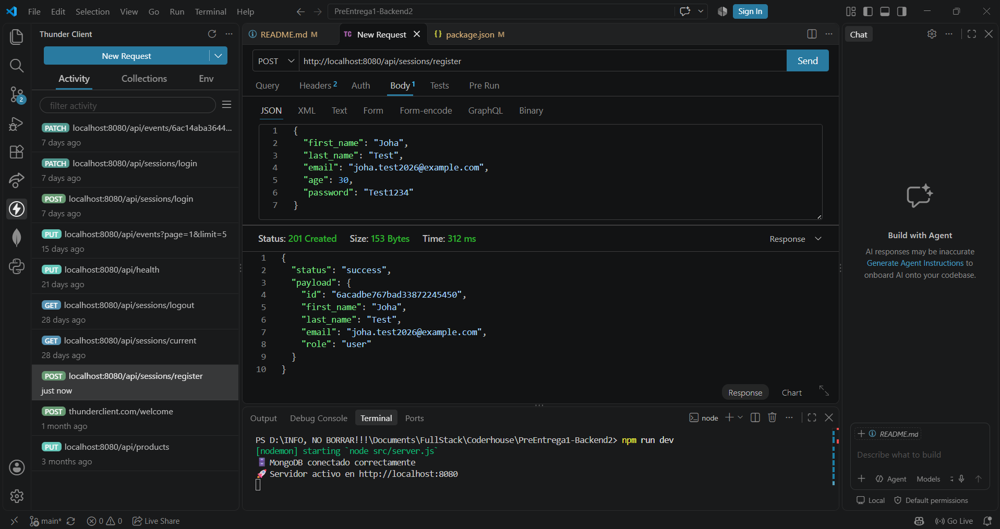 |
| Login (setea la cookie) | `200` | 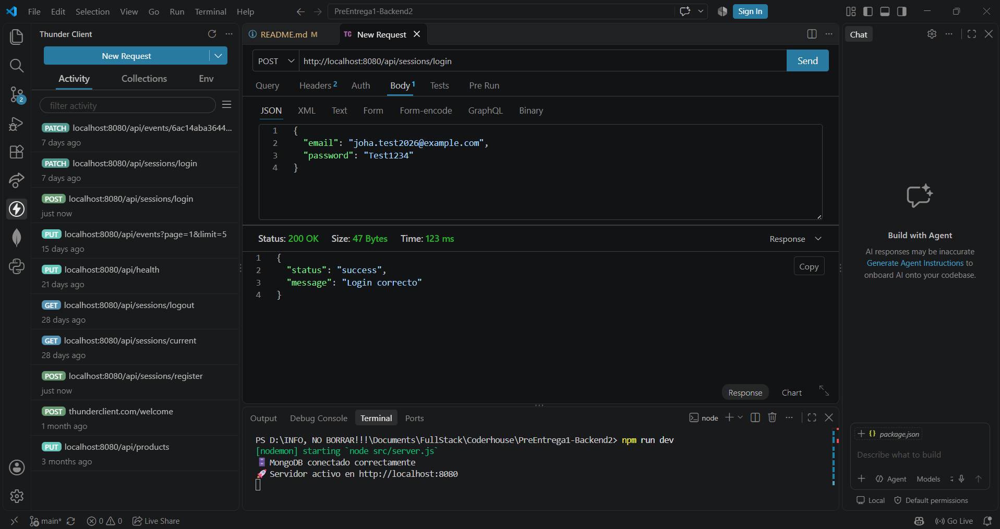 |
| `GET /current` con cookie, sin password | `200` | 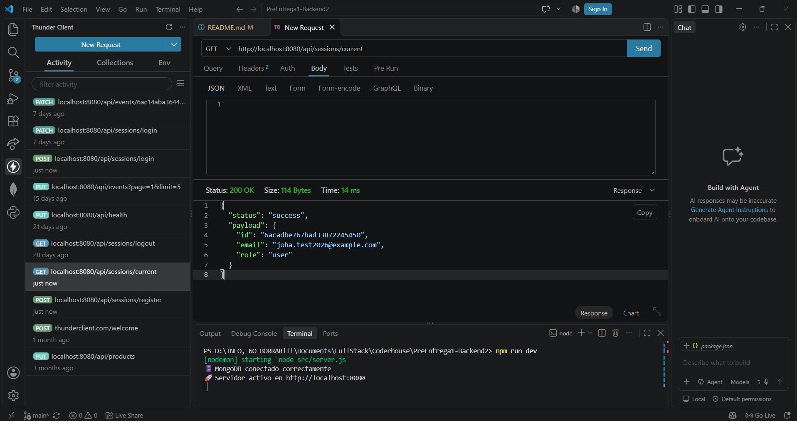 |
| `GET /current` sin cookie | `401` | 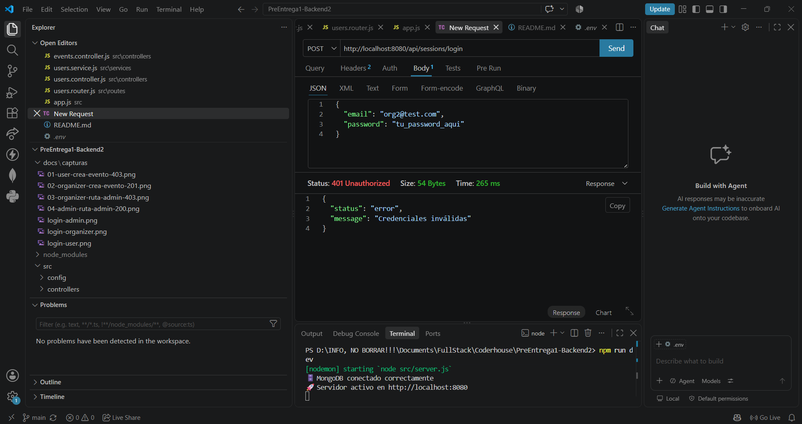 |

### Roles y permisos

| Caso | Resultado | Captura |
|---|:-:|---|
| `user` intenta crear un evento | `403` | 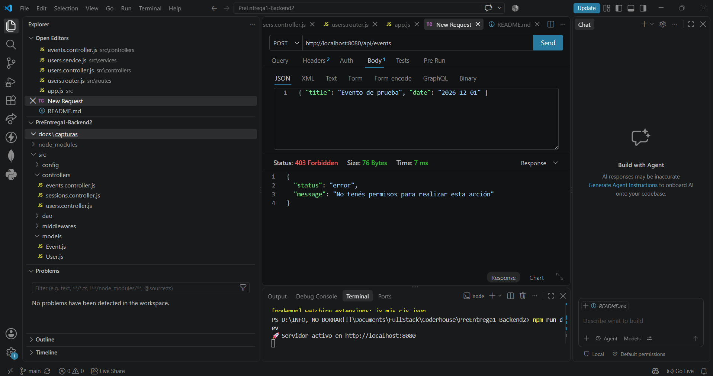 |
| `organizer` crea un evento | `201` | 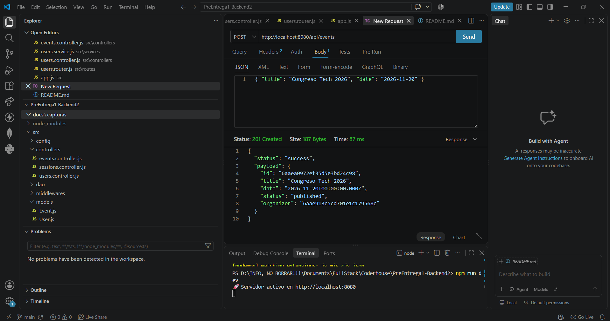 |
| `organizer` en ruta de administrador | `403` | 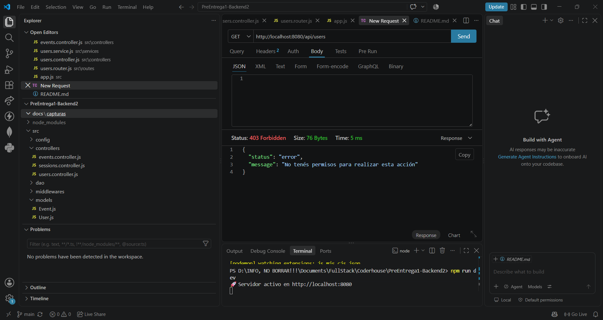 |
| `admin` lista usuarios, sin password | `200` | 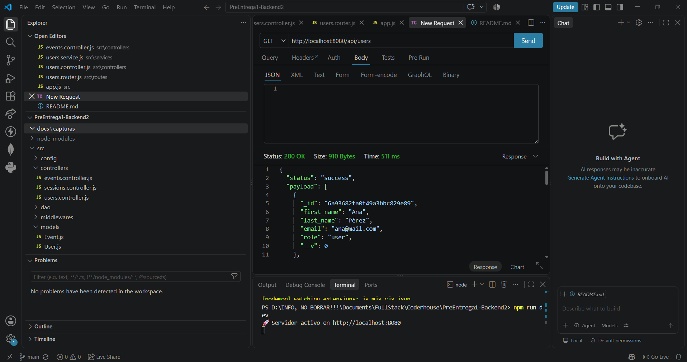 |
| `organizer` modifica su propio evento | `200` | 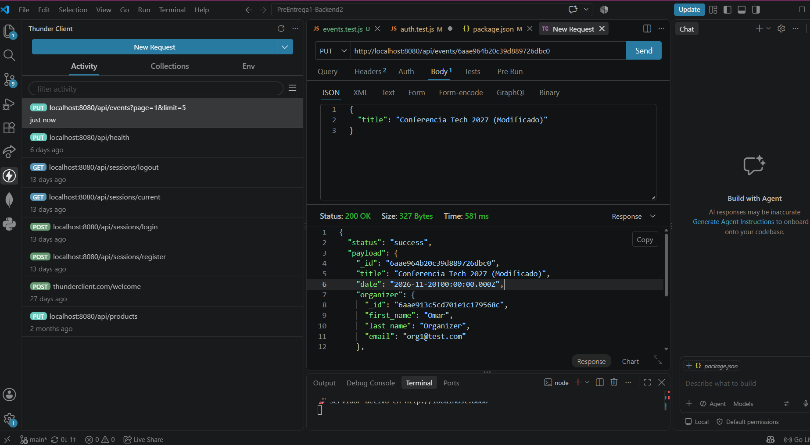 |
| `organizer` modifica un evento ajeno | `403` | 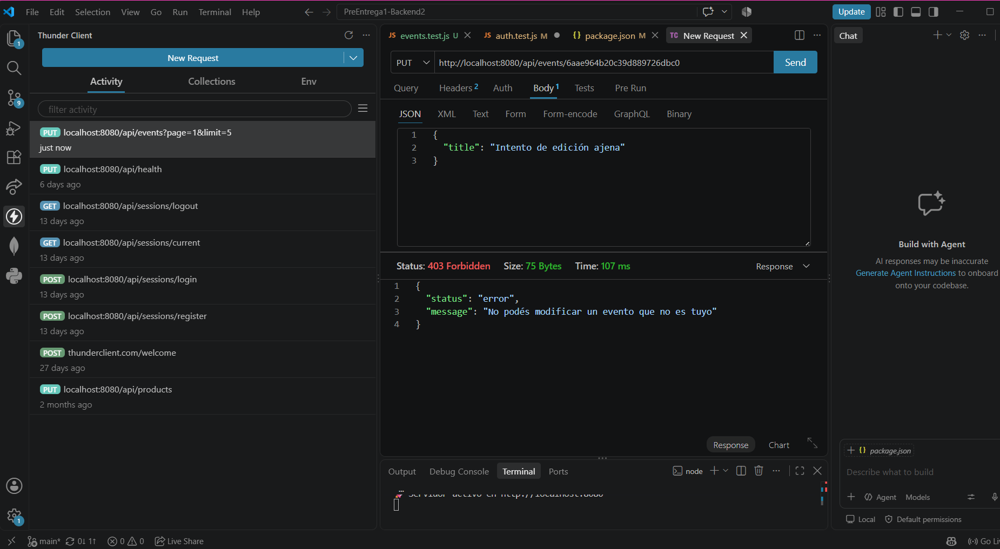 |
| `admin` modifica el evento de otro organizador | `200` | 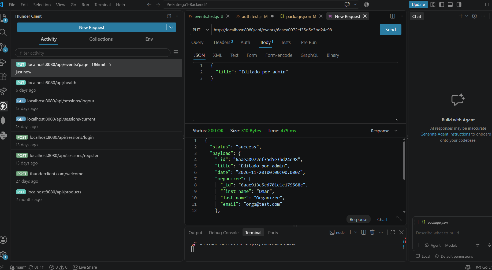 |

### Eventos

| Caso | Resultado | Captura |
|---|:-:|---|
| Crear evento con fecha pasada | `400` | 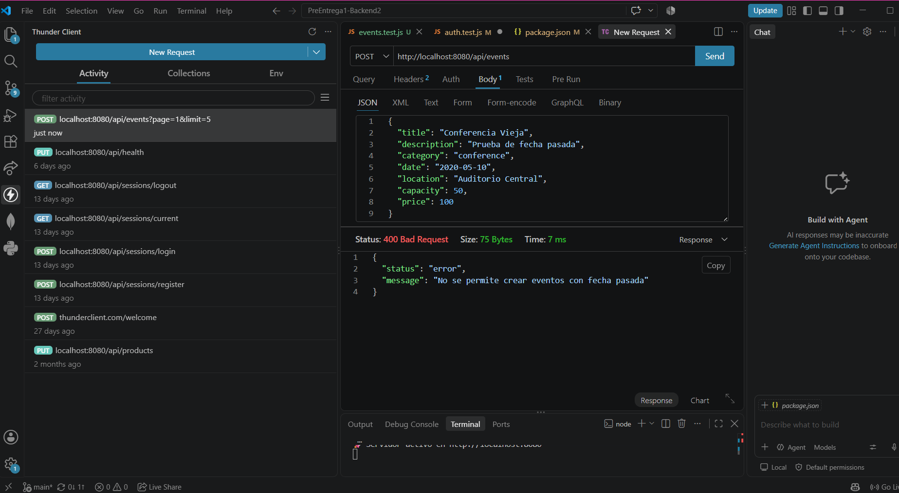 |
| Crear evento con `capacity: 0` | `400` | 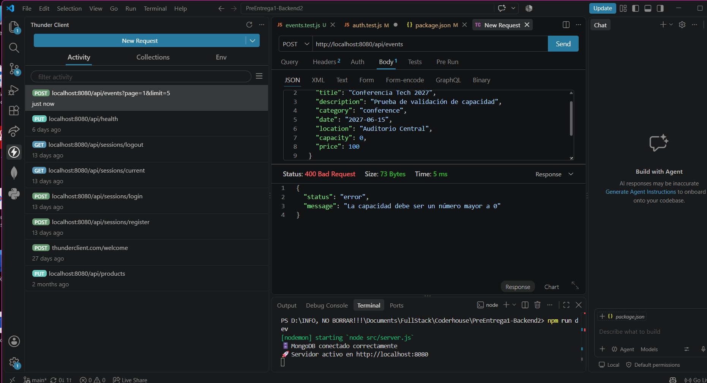 |
| Cambiar el estado de un evento cancelado | `400` | 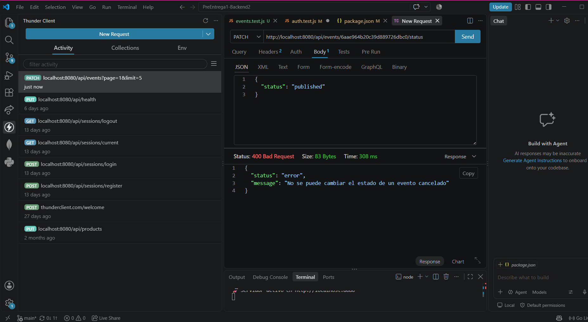 |
| Listado con filtros y paginación | `200` | 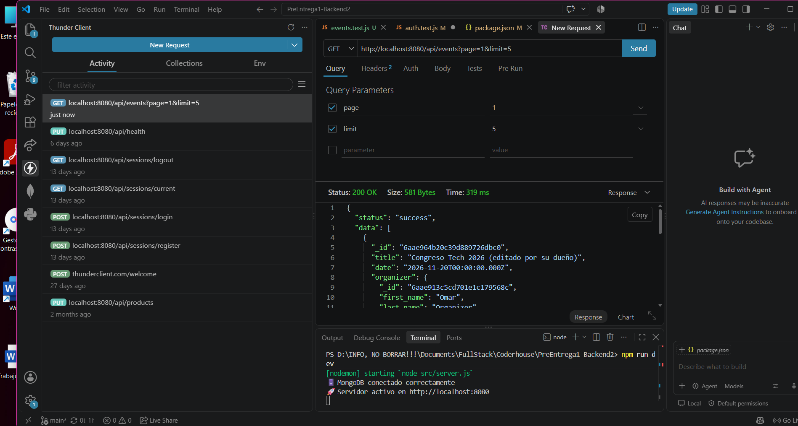 |

### Inscripciones

| Caso | Resultado | Captura |
|---|:-:|---|
| Inscripción sin sesión | `401` |  |
| Inscripción a un evento inexistente | `404` |  |
| Inscripción sin cupo suficiente | `409` |  |
| Inscripción exitosa con código de reserva | `201` |  |
| Inscripción duplicada | `409` |  |
| Mis tickets con `populate`, sin password | `200` |  |
| `user` consulta los tickets de un evento | `403` |  |
| `organizer` dueño consulta los tickets | `200` |  |
| Cancelación de un ticket ajeno | `403` |  |
| Cancelación propia, con `cancelledAt` | `200` |  |
